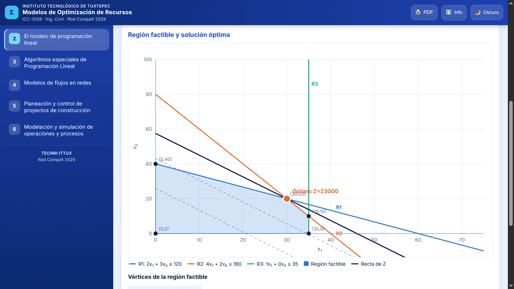

# 🧮 MODR APP — Modelos de Optimización de Recursos (ICC-1028)

<p align="center">
  <b>Herramienta Interactiva Web para Ingeniería Civil</b><br>
  Instituto Tecnológico de Tuxtepec (TecNM)
</p>

<p align="center">
  
</p>


## 🚀 Descripción de la Aplicación

**MODR APP** es una aplicación web interactiva de una sola página (SPA) diseñada para resolver, simular y visualizar problemas complejos de **Investigación de Operaciones** y optimización aplicados al ámbito de la Ingeniería Civil y la toma de decisiones gerenciales. 

La aplicación integra metodologías analíticas completas con gráficos vectoriales interactivos (`SVG`), modo claro/oscuro automático, diseño totalmente responsivo para dispositivos móviles y la capacidad de exportación e impresión directa a informes PDF profesionales.

---

## 📚 Unidades Temáticas y Módulos

La herramienta cubre de manera integral el temario oficial de la materia dividido en 6 unidades:

1. **Unidad 1: El enfoque sistémico en las organizaciones**
   * Toma de decisiones bajo incertidumbre y riesgo (Criterios de Maximax, Maximin/Wald, Laplace, Hurwicz, Savage y Valor Esperado / EVPI).
   * Constructor interactivo y diagrama visual de sistemas (Entradas, Procesos, Salidas, Retroalimentación y Ambiente).
   * Asistente inteligente selector de modelos matemáticos.

2. **Unidad 2: El modelo de programación lineal (PL)**
   * Planteamiento analítico y validación de variables de decisión.
   * Análisis de dualidad y precios sombra (Primal ↔ Dual).
   * Método gráfico interactivo con polígonos de regiones factibles y curvas de nivel de $Z$.
   * Método Simplex tabular paso a paso (incluyendo Fase 1 y Fase 2).
   * Análisis de sensibilidad (rangos para coeficientes de la función objetivo y recursos $b_i$).
   * Generador de código automatizado para LINGO y Python (`SciPy / HiGHS`).

3. **Unidad 3: Algoritmos especiales de Programación Lineal**
   * **Problema de Transporte:** Soluciones iniciales (Esquina Noroeste, Costo Mínimo y Vogel), balanceo de oferta/demanda y optimización mediante el método MODI (ruta de los signos). Visualización en red y flujos.
   * **Problema de Asignación:** Algoritmo Húngaro paso a paso con matrices de costos o beneficios y asignaciones óptimas.
   * Generador de scripts de optimización en Python.

4. **Unidad 4: Modelos de flujos en redes**
   * **Ruta más corta:** Algoritmo de Dijkstra con bitácora de etiquetado y matriz de distancias.
   * **Flujo máximo:** Algoritmo de Ford-Fulkerson, trayectorias de aumento y teorema del corte mínimo.
   * **Árbol de expansión mínima:** Algoritmos de Kruskal y Prim interactivos sobre grafos editables.
   * Generador de código en Python (`NetworkX`).

5. **Unidad 5: Planeación y control de proyectos de construcción**
   * **CPM / PERT determinístico y probabilístico:** Redes AON, cálculo de holguras, identificación de rutas críticas, distribución normal y probabilidad de cumplimiento de plazos ($P(T \le objetivo)$).
   * **Relación tiempo-costo (Compresión / Crashing):** Análisis de pendientes de costo y optimización de costos directos e indirectos.
   * **Nivelación de recursos:** Histograma de carga de trabajo, desviación estándar ($\sigma$) y reasignación de holguras.
   * Diagramas de Gantt interactivos y exportación de datos en formato CSV.

6. **Unidad 6: Modelación y simulación de operaciones y procesos**
   * **Generadores pseudoaleatorios:** Generador Congruencial Lineal (GCL) y pruebas estadísticas ($\chi^2$).
   * **Simulación Monte Carlo:** Variables aleatorias discretas y continuas.
   * **Líneas de espera (Colas M/M/c):** Simulación por eventos discretos y comparación teórica con fórmulas de sistemas de filas.
   * **Control de inventarios:** Simulación de políticas $(s, Q)$ con costos de mantenimiento, faltantes y pedidos.

---

## 🛠️ Tecnologías y Características Técnicas

* **Frontend:** HTML5, CSS3 Moderno (Variables CSS, Flexbox/Grid), JavaScript Vanilla (`ES6+`).
* **Gráficos y Visualización:** Motores gráficos personalizados basados en SVG puro para renderizado de funciones, diagramas de redes de nodos interactivos (`GraphView`), diagramas de barras, líneas y diagramas de Gantt dinámicos.
* **Arquitectura:** Sin dependencias externas ni servidores pesados de instalación; totalmente autocontenido en un solo archivo HTML ejecutable localmente en cualquier navegador moderno.
* **Diseño Adaptativo:** Interfaz responsiva con menú móvil lateral y soporte completo para impresión corporativa optimizada para formato A4.

---

## 💻 Instalación y Uso Local

No se requiere ningún entorno de compilación complejo ni instalación de librerías en servidor.

1. Clona el repositorio o descarga el archivo fuente:
   ```bash
 git clone https://github.com/rod-dev2026/Modelos-de-Optimizaci-n-de-Recursos.git
